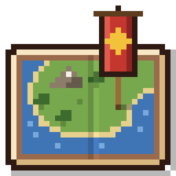

# Diorama

Diorama is a client-side mod for Minecraft, on Fabric for 1.21 to 26.3 and on NeoForge for 1.21 to 26.3, that draws your world as an angled voxel map, like a baked diorama, in a minimap and a fullscreen map you can pan and zoom.

The map is ray traced from the chunk data your client already has. The camera looks north and down at 50°, so you see block tops and their south faces. Each pixel's ray walks the real blocks, so overhangs, bridges and tree canopies come out right. A second ray toward a low sun casts long shadows, more rays measure how much sky each spot can see so the ground under trees and overhangs darkens, and higher ground is a little brighter, so hills still read as hills when you zoom far out. Water gets darker with depth. A "Depth shading" setting turns all of this down to a flatter look. Tiles bake on background threads and only re-bake the parts an edit can affect.

Places the map has no data for sit under animated fog. Underground, the map switches to a cave slice that shows the first open space below a cut a few blocks above your head, lit by the game's own block light. If a server sends Xaero's fair-play chat code (`§f§a§i§r§x§a§e§r§o`), cave slices only show blocks you've had line of sight to.

## What it does

- **Minimap** in a corner of your choice, with a compass, coordinates and biome. `=` and `-` zoom it. Its frame can be a thin border or the paper of a vanilla map held in hand (Settings → Minimap → Frame), with the compass inked on the margin and the map's edge torn into the paper.
- **Fullscreen map** with smooth, cursor-anchored wheel zoom, from close-up blocks out to about 10,000 blocks across. It opens with a short zoom in, and its menus are a pixel-art **book** over the map: colored ribbons at the right edge, each with an item icon from your resource pack, open its sections (Banners, Look, Layers, Radar). Settings that change the world map are changed there, with the map live around the book; only the minimap's own settings leave the map.
- **Radar** for other players and mobs, each shown as its own face, framed red, yellow or green for hostile, neutral or passive, with markers for whether they're above or below you.
- **Waypoints** on the map and as labels in the world, plus a marker wherever you die. Each waypoint is a pixel-art banner standing on its block, designed like at the loom: base dye, up to six pattern layers (sixteen if you lift the limit in the settings), every pattern the game has registered, including datapacks' and mods', undo and redo, and a button that copies the banner you're holding. Share one in chat from its edit screen; shared waypoints, including Xaero's, get an [Add] link in chat. Teleport to one if you're allowed to use `/tp`. Coming from Xaero's Minimap? The waypoint list offers to import its waypoints for the world you're in.
- **Saved map.** Everything your client loads is saved per world and dimension, so the map is still there next time, and you can zoom out over everywhere you've been.
- **The Nether** from above: the sky view starts under the bedrock roof and shows everything below it, lit by block light.
- **Overlays** on the fullscreen map: chunk grid, slime chunks (singleplayer) and the spots where monsters can spawn.
- **Settings** for all of the above, in the fullscreen map's book, and in one screen from a key or Mod Menu.

Saved maps and waypoints live in `.minecraft/diorama/`, one folder per world. On a server, each world behind its address gets its own folder, told apart by the world seed the server sends, so a network's lobby and survival worlds, or a map reset, don't mix.

## Keys

- `M` opens the fullscreen map. Drag to pan, scroll to zoom, click a banner to open its page in the book. Right-click anywhere for a menu: plant a banner there (named in the book), copy its coordinates, or teleport there if the server lets you use `/tp` (on ground the map hasn't seen, `/spreadplayers` lands you on the surface).
- In the fullscreen map, `C` toggles the cave slice, `PgUp`/`PgDn` move the slice by 4 blocks, `U` opens the book's banners, `Space` recenters on you, and `Esc` shuts the right-click menu, then the book, before the map.
- `B` adds a waypoint where you stand, and `U` opens the waypoint list.
- `=` and `-` zoom the minimap. Map settings and hiding the minimap have keys too, unbound by default.

## Building

Needs JDK 25. Gradle downloads everything else.

One source tree builds a jar for each supported Minecraft version, using [Stonecutter](https://codeberg.org/stonecutter/stonecutter). The source is written for the newest version, 26.3. Names that only changed between versions are translated by the replacements in `stonecutter.gradle.kts`. Code that differs in other ways sits in `//? if >=26.1 { … //?} else { /* … *///?}` blocks, with the older version commented out. Keep the active version at 26.3: the replacements only translate in one direction.

```sh
./gradlew :26.3:build
./gradlew :26.2:build
./gradlew :26.1:build   # also runs on 26.1.1 and 26.1.2
./gradlew :1.21.11:build
./gradlew :1.21.1-neoforge:build   # NeoForge 21.1.178 or later; every NeoForge version is <minecraft>-neoforge
```

Each jar lands in `versions/<version>/build/libs/`. 1.21.11 ships obfuscated, so its build remaps the mod to the names a normal install uses.

Versions named `<minecraft>-neoforge` build for NeoForge; the rest build for Fabric. NeoForge gets a jar for each Minecraft version it has a stable release for: 1.21, 1.21.1, 1.21.3, 1.21.4, 1.21.5, 1.21.8, 1.21.10, 1.21.11, 26.1.2, 26.2 and 26.3. From 1.21.6 the map draws through parts of the game that are private; Fabric API's access wideners open them for the Fabric jars, and a per-version access transformer, written by `build.neoforge.gradle.kts`, opens them for the NeoForge jars. Everything but the entrypoints is shared: `dev.diorama.fabric` hooks the mod up to Fabric API and `dev.diorama.neoforge` to NeoForge's events, and each jar contains only its own package and metadata (`fabric.mod.json` or `META-INF/neoforge.mods.toml`). Other differences between the loaders sit in `//? if fabric` and `//? if neoforge` blocks.

`./gradlew :26.3:runClientGameTest` (or `:1.21.11:runClientGameTest`) launches the game, creates a world and runs every test scenario: the map views, radar, waypoints, importing waypoints from Xaero's Minimap, fog of war, settings, overlays, the Nether and the End, saving the map across a restart, and two worlds on one dedicated server. Each scenario asserts what it can measure and saves screenshots to `versions/<version>/build/run/clientGameTest/screenshots/` for the rest. Set `DIORAMA_TESTS` to a comma-separated list (`tour`, `radar`, `waypoints`, `xaero-import`, `fog-of-war`, `settings`, `overlays`, `dimensions`, `saved-map`, `multiplayer`) to run only some, `DIORAMA_GIF=1` to also save frames for GIFs, and `DIORAMA_DEBUG=1` for extra logging. `DIORAMA_TESTS=showcase` isn't part of the default run: it builds a castle beside a village and takes the screenshots for the store page.

`./gradlew :1.21.1-neoforge:runClientGameTest` runs the same scenarios on NeoForge, all but the dedicated server one. NeoForge has no client game test API, so they run on `src/gameshim`, the test-only stand-in for Fabric's that the Fabric jars before 1.21.4 use too.

`./gradlew :1.21.11:runProductionClientGameTest` runs the same tests against the remapped release jar in a normal install, with Fabric API as published. In development 1.21.11 uses Mojang's names, but a normal install uses intermediary ones, so anything that looks the game up by name only fails there.

## Contributing

Use JDK 25 and the checked-in Gradle wrapper. Keep Stonecutter active at 26.3.
`./gradlew --configure-on-demand :26.3:build` runs the fast JUnit regression tests as well as compiling the mod.
The tests cover rotated and negative coordinates, dirty regions, retry backoff, cache limits and disk persistence.
`DIORAMA_TESTS=directions ./gradlew --configure-on-demand :26.3:runClientGameTest` exercises all four map orientations inside Minecraft.
The GitHub Actions workflow builds every supported version and runs selected client scenarios on 26.3.

Map direction is configured in Settings under Look. North is the default; East, South and West preserve the angled camera.
Saved maps use separate folders per direction. Existing north-facing maps keep their original paths.

The map is pixel perfect on a block grid. The camera keeps its angled view, scaled up the
screen so every visible block face, top or side, is exactly 4 map pixels wide and 3 tall (close
to the proportions before the grid) and every block
edge lies on a pixel boundary. Each pixel shows a single face and takes one ray through its
middle, so shadows and light fall per texel and baking is about four times quicker than the
four rays a pixel took before. Outlines come from the faces' own geometry: one pixel at the
block edges where one surface hides another, never from what lies under water. On screen,
once a map pixel covers a screen pixel or more, the map rests at a whole number of screen
pixels per map pixel and lines up with the screen's pixels (GUI scale included): magnified wheel
steps go to the next whole number and the zoom glides between them; smaller pixels blend
through mipmaps. Maps saved before the grid stay in their folders (`surface`, `surface-50`,
`surface-grid-45`); the grid map is saved in `surface-grid3-45` and starts empty.

Appearance changes such as the render style and depth shading are prepared in the
background, the tiles on screen first: those change together, in one frame, as soon as all
of them are ready, and the other resident tiles follow a few at a time where no view shows
them. Exploration stays visible while it prepares, and distant overviews wait for every
updated detail tile and change together last.
In singleplayer on 26.3, tiles whose chunks aren't loaded are redrawn from the chunks
the world saved, nearest the open views first, including tiles under zoomed-out overviews.
Only pixels already explored are redrawn; nothing unexplored appears. Each saved tile
records whether it shows the current look (`appearance.bin`), so a look changed before
leaving the world is applied the next time those tiles are shown. Elsewhere (multiplayer,
older versions) historical pixels whose terrain is no longer available retain their saved
appearance until revisited; their original geometry and lighting cannot be recovered from RGB alone.

`DIORAMA_TESTS=whole-map-refresh` forgets the loaded snapshots, changes the look and checks the
redraw from saved chunks reveals nothing new.

Reopening a map is fast: tiles no loaded chunk can change are shown straight from disk
without tracing, up to three tile uploads per GUI frame, and new discoveries ease in
with a 420 ms ease-out that keeps receding while tiles stream in.

The map pipeline is `MapSession -> ChunkSnapshot -> MapLevel -> TileBaker -> MapTile/TileStore`.
`BakeScheduler` owns CPU task results; `TileInvalidation` computes dirty regions; `TileCache` owns GPU eviction.
Session retirement freezes chunks and settings and finishes unsaved surface tiles asynchronously. Application shutdown waits for those saves.

When Mod Menu is installed on Fabric, Diorama's configure button opens the settings screen with every setting; the world map's book and that screen are built from the same list (`SettingsCatalog`).
Mod Menu is optional. To verify its entrypoint in development, use
`DIORAMA_TESTS=modmenu ./gradlew --configure-on-demand -PdioramaModMenuTest=true :26.3:runClientGameTest`.

The fork's branch and validation workflow is documented in [CONTRIBUTING.md](CONTRIBUTING.md).
Day/night lighting is available on **Fabric 26.3**. In Settings → Look → Lighting, choose World time (default), Always day or Always night. The minimap and world map share this setting. Surface tiles blend their saved day/night colors as the world's sky and weather change; changing the clock does not rebuild terrain or reset exploration. Torches, lanterns and lava illuminate nearby mapped surfaces at night.

Caves, roofed dimensions and the End retain their existing lighting. Decorative shadows keep a fixed direction; colored-light mods are not modeled. Earlier Fabric versions and NeoForge retain daytime surface rendering until their GPU backends are ported.

Existing `.omt` maps remain intact. New `.omt2` bundles store both endpoints together; old pixels use a dimmed approximation until revisited. GPU map textures, mips and overlays share a 256 MiB budget, with up to three tile uploads per GUI frame on 26.3.

`DIORAMA_TESTS=banner-waypoints ./gradlew --configure-on-demand :26.3:runClientGameTest` places banner waypoints around the player and captures them on the fullscreen map (both sizes, gathered, on the edge, in sepia), on the minimap (also in its map-paper frame) and in the banner editor, asserting the layout, sharing through chat and editing with undo. See [the design](docs/design/banner-waypoints.md).

`DIORAMA_TESTS=book-map ./gradlew --configure-on-demand :26.3:runClientGameTest` opens the world map and checks its zoom in, captures each section of the book, picks a look in the book (the map redraws behind it without leaving), tints the antique map without redrawing tiles, goes out through the minimap ribbon and back, opens a banner's page from the map, types its name without the map's keys firing, and checks the pages at 1280x720. See [the design](docs/design/book-map-ui.md). The book's sprite sheet is drawn by `docs/design/book-sprites.py`.

`DIORAMA_TESTS=day-night ./gradlew --configure-on-demand :26.3:runClientGameTest` checks real block-light propagation in all four directions and both quality modes, captures lighting states and asserts zero jobs, writes, snapshots or fog-mask rebuilds during a time-only cycle. See [the design](docs/design/day-night-lighting.md) and [validation report](docs/testing/day-night-lighting.md).

## Painted render style

Settings → Look → Render replaces the old outlines toggle with **Plain**, **Outlined** (the
default, the previous look), **Painted** and **Painted, no outlines** (the same paint without any
ink lines). Painted turns explored terrain into a hand-painted
fantasy map: block textures and soft shading melt into flat areas of paint, light is cel shaded
(one sunlit colour, one bluish shadow colour), soft sepia ink lines follow edges and colour
boundaries, coasts are inked with a line of foam, water steps from pale shallows to deep teal
in flat washes ringed by light lines, and faint brushwork, an uneven wash and paper grain sit on
top. It is computed while baking tiles, so it works on every version and loader; switching keeps
exploration and redraws the map like any other look change. Older configs keep their choice:
outlines on becomes Outlined, off becomes Plain.
`DIORAMA_TESTS=painted DIORAMA_RENDER_DISTANCE=8 ./gradlew --configure-on-demand :26.3:runClientGameTest`
captures a village and a coast in all three styles, the painted village further out, the minimap
and night. `DIORAMA_RENDER_DISTANCE` (default 12) lowers the loaded area for quicker runs of
scenarios that only look near the player. See [the design](docs/design/painted-style.md) and
[the block grid](docs/design/pixel-grid.md).

## Antique map style (fork 0.4.0)

Settings → Look → Fog style offers **Clouds** (the existing default), **Antique map** (sepia)
and **Antique map (color)**. Both styles are pixel art: one GUI pixel per art pixel at every
zoom, aligned to the screen, or one block per art pixel once a block is larger. Clouds are
terraced pixel puffs with shaded undersides and a dithered shadow.
Antique map shows explored terrain in its own colors, lightly desaturated and warmed;
**Antique: tint explored** (on by default, for both antique styles) can turn that off, so the
explored map keeps the render style's colors and only the unknown is drawn as an old map.
Unknown areas are drawn in sepia ink (or biome colors): parchment, light biome washes,
pixel coastlines with foam and offshore dashes, and wavelets at sea when a compatible seed
sampler is available. The explored frontier is a frayed pixel ink line, irregular like a
hand-colored map, that stays inside the explored terrain. In both styles, terrain holes at the explored
edge show the unknown style instead of a flat background. Both styles ease new discoveries in
over 420 ms. Switching styles does not reset exploration or rebake terrain.

Seed cartography initially supports the singleplayer Overworld on **26.3** with
compatible noise generation, on Fabric and NeoForge. Biome datapacks (custom biomes,
noise and parameter lists) are read from the world's own registries; biomes are classed
by their `minecraft:`/`c:` tags, else by name. Mods with their own chunk generator or
biome source fall back to plain parchment. It samples only biomes, never
generates chunks, and does not predict structures or exact height/coastlines.
Other contexts keep the parchment without prediction. Seed cartography can be
switched off independently. Older versions retain the paper style and eased zoom.
See the [implementation](docs/design/antique-fog.md) and
[validation results](docs/testing/antique-fog.md).
